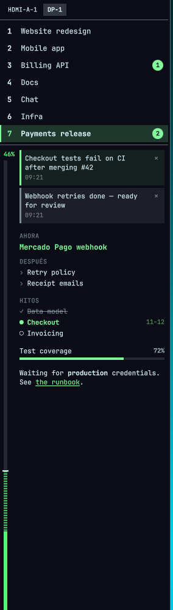

# Workspace Sidebar for Omarchy

A left sidebar for the Omarchy 4 shell that keeps two things in view at all times: **which workspace has
focus**, and **how far along the project on that workspace is**. It pairs with Claude Code, so each
workspace's agent session can keep its own progress panel up to date and leave you notices.



> The interface text is in Spanish (e.g. *Ahora*, *Después*, *Hitos*). Everything else (files, CLI,
> configuration) is language-neutral.

## Features

- **Workspace list** — number and an editable title per workspace (double-click to rename). The focused
  workspace is highlighted and briefly glows when it gains focus; empty workspaces are dimmed, like the
  bar's workspace widget. Each row counts its unread notices.
- **Progress panel** for the focused workspace, with its own scroll:
  - a thin vertical **progress strip** filled bottom-up, with a tick showing where you should be today
    given the start date and deadline; falling behind is hatched, so it reads in any theme;
  - blocks: **notices** (dismissable), **focus** (now / next), **milestones**, Markdown **notes**, and
    secondary **meters**.
- **Live updates** — each workspace's content is a JSON file that the panel watches.
- **Monitor selector** at the top, show/hide via IPC or a keybinding, resizable by dragging the right
  edge. Position, width and visibility persist.
- **Theme-aware** — colors, fonts and spacing come from the active Omarchy theme.
- **Optional Claude Code integration** — a skill and hooks let a session size the project, mark
  progress, and post "waiting for you" notices, only for sessions you explicitly connect.

## Requirements

| Dependency | Needed for | Notes |
|---|---|---|
| Omarchy 4 (Quattro) | the sidebar | Quickshell-based `omarchy-shell` |
| Python 3 (stdlib only) | `wsbar`, the CLI that writes panel content | preinstalled on Omarchy |
| `jq` | Claude Code hooks | preinstalled on Omarchy |
| [Claude Code](https://claude.com/claude-code) | optional integration | not needed for the sidebar itself |

No network access, no root, no services, no remote builds.

## Install

```bash
omarchy plugin add https://github.com/codice-coop/omarchy-workspace-sidebar.git --enable
omarchy restart shell
```

The sidebar appears on the focused monitor. The plugin lives in
`~/.config/omarchy/plugins/io.github.codice-coop.workspace-sidebar/`.

Optional steps — nothing below is done for you; each one edits your own configuration only if you run it.

**Keybinding** — add to `~/.config/hypr/bindings.lua` (check that the combo is free in your setup):

```lua
o.bind("SUPER + ALT + B", "Workspace sidebar", "omarchy-shell shell call io.github.codice-coop.workspace-sidebar toggle ''")
```

**CLI** — put `wsbar` on your `PATH`:

```bash
ln -s ~/.config/omarchy/plugins/io.github.codice-coop.workspace-sidebar/bin/wsbar ~/.local/bin/wsbar
```

**Claude Code** — see [Claude Code integration](#claude-code-integration).

## Usage

- **Show / hide**: the keybinding, or
  `omarchy-shell shell call io.github.codice-coop.workspace-sidebar <toggle|show|hide> ''`.
- **Move to another monitor**: the buttons at the top, or `… moveTo <monitor-name>`.
- **Resize**: drag the right edge (180–600 px).
- **Rename a workspace**: double-click its title, Enter to save, Esc to cancel, empty to reset.
- **Dismiss a notice**: the × on the notice.

### Writing panel content

Each workspace reads `~/.config/workspaces/sidebar/workspaceN.json`. Write it with `wsbar`, which
validates every change and writes atomically, so the panel never sees a half-written file. By default it
targets the workspace of the terminal it runs in.

```bash
wsbar where                                            # workspace of this terminal
wsbar progress --label "Release 1.2" --percent 40 --start 2026-11-01 --deadline 2026-11-30
wsbar focus --now "Payments webhook" --next "Retry policy" --next "Receipt emails"
wsbar notice add --level warn -- "CI is red on main"
wsbar milestones set -- '[{"label":"Checkout","status":"current","date":"2026-11-12"}]'
wsbar text notes -- "Waiting for **production** credentials"
wsbar scroll bottom                                    # or top, a block id, or 0..1
wsbar --help
```

For ongoing projects, `wsbar plan set|done|show` and `wsbar publish` keep a weighted plan per git
repository (in `~/.local/share/wsbar/projects/`) and derive the percentage from it.

## Configure

| What | Where |
|---|---|
| Monitor, width, visibility, titles, dismissed notices | `~/.config/workspaces/sidebar/_sidebar.json` (written by the sidebar) |
| Panel content | `~/.config/workspaces/sidebar/workspaceN.json` (written by `wsbar`) |
| Per-project plans | `~/.local/share/wsbar/projects/` |
| Claude Code session links | `~/.config/workspaces/sidebar/_sessions.json`, `~/.local/state/wsbar/` |

The full file format is in the
[design spec](docs/superpowers/specs/2026-11-06-workspace-sidebar-design.md).

## Claude Code integration

Optional. It lets one Claude Code session per workspace keep that workspace's panel current.

**1. Install the skill** (the `progreso` skill, instructions in Spanish):

```bash
ln -s ~/.config/omarchy/plugins/io.github.codice-coop.workspace-sidebar/skills/progreso ~/.claude/skills/progreso
```

**2. Install the hooks** — link the hook entry point, then add the six events to the `"hooks"` object of
`~/.claude/settings.json`. If an event already has entries (yours or another tool's), append this group to
its list instead of replacing it.

```bash
ln -s ~/.config/omarchy/plugins/io.github.codice-coop.workspace-sidebar/hooks/claude-hook ~/.local/bin/wsbar-claude-hook
```

```json
{
  "hooks": {
    "SessionStart":     [{ "hooks": [{ "type": "command", "timeout": 5, "command": "$HOME/.local/bin/wsbar-claude-hook SessionStart" }] }],
    "Stop":             [{ "hooks": [{ "type": "command", "timeout": 5, "command": "$HOME/.local/bin/wsbar-claude-hook Stop" }] }],
    "Notification":     [{ "hooks": [{ "type": "command", "timeout": 5, "command": "$HOME/.local/bin/wsbar-claude-hook Notification" }] }],
    "UserPromptSubmit": [{ "hooks": [{ "type": "command", "timeout": 5, "command": "$HOME/.local/bin/wsbar-claude-hook UserPromptSubmit" }] }],
    "PostToolUse":      [{ "hooks": [{ "type": "command", "timeout": 5, "command": "$HOME/.local/bin/wsbar-claude-hook PostToolUse" }] }],
    "SessionEnd":       [{ "hooks": [{ "type": "command", "timeout": 2, "command": "$HOME/.local/bin/wsbar-claude-hook SessionEnd" }] }]
  }
}
```

**3. Connect a session.** Sessions start **disconnected**: a session that is not connected cannot write to
any panel, and the hooks do nothing for it. In the session you want on a workspace:

- `/progreso conectar` — connects it to the workspace of its terminal (one session per workspace;
  connecting another replaces the previous one and says so). The row shows a small indicator.
- `/progreso` — Claude reads the repo (docs, plans, git log, open PRs), proposes a goal, weighted items,
  milestones and focus, asks for the deadline if it is not written down, and publishes it.
- From then on it marks items done, updates the focus, and leaves notices; the hooks republish the plan at
  session start and post a "Claude is waiting for you" notice that clears when you reply.
- `/progreso desconectar` and `/progreso estado` to disconnect or check.

From a plain terminal (outside Claude Code) `wsbar` has no restrictions.

For unconnected sessions the hooks exit in a few milliseconds (one `jq` call and a file check, no Python),
print nothing and always exit 0, so they never block Claude Code. Errors go to
`~/.local/state/wsbar/hook.log`.

## Remove

```bash
omarchy plugin remove io.github.codice-coop.workspace-sidebar
rm -f ~/.local/bin/wsbar ~/.local/bin/wsbar-claude-hook ~/.claude/skills/progreso
```

Then delete the six `wsbar-claude-hook` entries from `~/.claude/settings.json` and the keybinding line from
`~/.config/hypr/bindings.lua` if you added them. To also delete the data:

```bash
rm -rf ~/.config/workspaces/sidebar ~/.local/share/wsbar ~/.local/state/wsbar
```

## Security

Plugins run unsandboxed inside `omarchy-shell`, which also hosts the lock screen and the polkit agent, so
the plugin is written defensively:

- **Untrusted content.** Panel text can originate, indirectly, from repositories an agent reads. `wsbar`
  validates every write and caps sizes, nesting and lengths; the sidebar caps them again, never loads
  images, never interprets HTML, and only opens `https://` links, showing the real target on hover.
- **Minimal IPC.** The plugin exposes only `toggle`, `show`, `hide` and `moveTo`.
- **No shell interpolation.** Commands are run with argument lists; the only workspace dispatch accepts an
  integer 1–10.
- **Agent control.** Claude Code sessions can write only to the workspace you connected them to.
- **Updates.** `wsbar`, the skill and the hook are symlinks into the plugin checkout, so
  `omarchy plugin update` updates them too. Install only from a source you trust.

## Development

```bash
node --test tests/model/                        # sidebar logic (SidebarModel.js)
python3 -m unittest discover -s tests/wsbar     # wsbar and hooks
omarchy plugin validate .
omarchy restart shell                           # the plugin is keepLoaded: QML changes apply on restart
```

## License

[MIT](LICENSE) © 2026 CODICE
